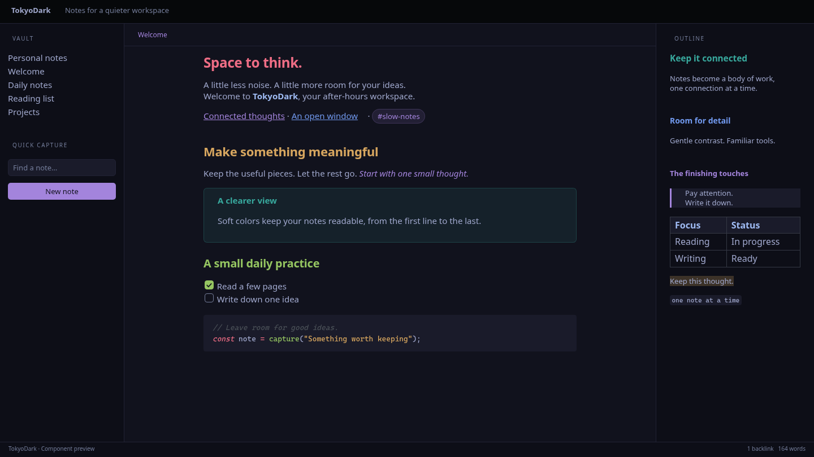

# TokyoDark

A dark Obsidian theme with deep indigo backgrounds, lavender accents, and warm syntax colors for focused writing and coding.



*Browser-rendered component preview.*

## Install

1. Copy `theme.css` and `manifest.json` into your vault's `.obsidian/themes/TokyoDark/` folder.
2. Open **Settings → Appearance**, choose **Dark**, and select **TokyoDark**.

Requires Obsidian 1.13.0 or newer. Light mode uses Obsidian's default appearance.

## Development

Edit `theme.css` directly; no build step is required.

```sh
npm ci
npm run lint
```

Generate desktop and mobile previews in `screenshots/`:

```sh
npx playwright install chromium
just preview
```

Use `just show` to generate and open the desktop preview in your default image viewer.

Edit `scripts/preview.html` to change the sample content and layout.
